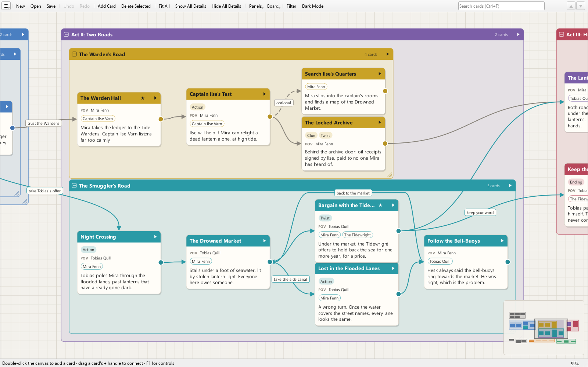

# WarpingWeft

A desktop canvas for mapping branching and converging story paths. Story cards can be moved
around freely, linked with directed arrows and gathered into groups. Each card can carry tags,
characters, locations and a status (together called *strands*), and story tools show the routes
through the story, where characters are introduced, and loose ends.



*Act II of `examples/lantern-tide.json`, one of the demo boards.*

## Setup

```powershell
py -3.13 -m venv .venv
.venv\Scripts\python.exe -m pip install -r requirements.txt
```

`requirements.txt` pins the exact version of PySide6-Essentials (Qt's core modules; the app
doesn't need the larger add-ons) the app is tested with. To upgrade, change
it, reinstall, and run the tests.

## Run

Double-click **`WarpingWeft.bat`** (sets up the environment automatically on first run).
Dragging a board `.json` onto it opens that board. Or from a terminal:

```powershell
.venv\Scripts\python.exe main.py               # empty board
.venv\Scripts\python.exe main.py my_story.json # open a board
```

## Tests

```powershell
.venv\Scripts\python.exe -m pip install -r requirements-dev.txt
.venv\Scripts\python.exe -m pytest
.venv\Scripts\python.exe -m ruff check .      # lint (settings in ruff.toml)
```

The pure-Python modules (`model`, `graph`, `layout`, `filters`, `routes`, `checks`, `export`,
`history`, `backups`) are tested directly; canvas and window behaviour runs headless through Qt's offscreen platform. Each test
uses a throwaway settings file, backup, recovery and log folders, and Documents folder (via the
`WARPINGWEFT_SETTINGS_FILE`, `WARPINGWEFT_BACKUP_DIR`, `WARPINGWEFT_RECOVERY_DIR` and
`WARPINGWEFT_LOG_DIR` environment variables), so running the suite never touches your real
preferences, backups or boards.

**Unexpected errors** are written to `%LOCALAPPDATA%\WarpingWeft\logs\error.log` (kept under
about 1 MB; the previous log is kept as `error.log.old`) and reported in a dialog; the app keeps
running. Set `WARPINGWEFT_LOG_DIR` to use another folder.

## Controls

<!-- controls:start (generated from warpingweft/controls.md: edit that file, then run `python -m warpingweft.help_text`) -->

### Cards

| Action | How |
|---|---|
| Add card | Double-click empty canvas, right-click → Add card, or Ctrl+Shift+N. Cancelling the editor for a new card removes it again |
| Edit card | Double-click it, or select it and press Enter |
| Card panel | View → Card Panel (Ctrl+Shift+E; also in the Panels menu) shows the selected card's title, description, tags, characters, POV, locations, status and notes beside the board. Click a card and type: there's no OK, and what you type is saved when you pause, leave the field or pick another card, each save one undo step. The mouse wheel scrolls the panel even over POV or Status, so it never changes them by accident. Double-click still opens the editor; the panel's *More…* button does too, for colour, type and a group's cards. With several cards selected it offers *Edit N Cards…* |
| Edit several cards | Select them, then Enter, Ctrl+E or right-click → Edit N selected cards…: change color, add or remove tags, characters and locations, set status (anything left alone stays as it is on each card; removing a card's POV character clears its POV; strand cards only take the color) |
| Move | Drag a card (a group brings its cards along); drag on empty canvas to box-select |
| Nudge | Arrow keys move the selection 10 px (Shift: 1 px); holding a key is one undo step |
| Snap to grid | View → Snap to Grid (or Settings), off by default: cards land on the 25 px grid when you drop or nudge them, new cards start on it, and arrow keys step to the next grid line (Shift+arrow still moves 1 px). Cards you don't move stay where they are |
| Copy / cut / paste / duplicate | Ctrl+C / Ctrl+X / Ctrl+V / Ctrl+D. Groups bring their cards; arrows come along when both ends are copied. Paste goes to the mouse pointer (onto a group to add to it) and works between windows; Ctrl+D places the copy beside the original |
| Delete | Del key; deleting more than one item at once (or a group with its cards) asks for confirmation |
| Card keys | The **Card** menu (Alt+C, or in ☰) holds the commands for the selection, each with a key: **L** Connect to…, **D** show or hide details, **C** collapse or expand group, **Ctrl+Shift+A** auto-arrange group, **O** not part of the story, **R** reverse arrows, **Shift+C** collapse or expand all groups, **Shift+D** show or hide all details. Group commands act on the selected groups or, if only cards are selected, on the groups they're in. On a mixed selection a toggle goes one way: if any is open (or in the story), they all close (or leave it). With nothing to act on, the status bar says what to select. The right-click menus show each item's key beside it too |
| Which keys act on the board | Del, Ctrl+A/X/C/V/D/E, H and the Card menu's keys act on the board only while the canvas has keyboard focus, so pressing them in a side panel (Card List, Filter, Strands, Routes, Story Checks, Path Reader) doesn't touch your cards. Click the canvas to give it focus (opening a board, clicking a Story Checks result or pressing Enter in the Card List does this for you). Their Edit / View menu entries work from anywhere |
| Show/hide card details | Click ▸ on the card's header (hidden by default), or select cards and press D; View → Show / Hide All Details (or Shift+D) for every card. Opening details makes room: cards and groups the card would now cover move down out of the way (and so does anything they bump into, including around its groups), and move back when the details close, unless you've moved them since. Making room isn't an edit: undo and saving keep the cards where they are with details closed. The card's arrows stay where they meet it closed, so nothing jumps |
| Tags / characters / locations | In the editor, type and press Enter (autocompletes from the board's strands); × removes; ▾ shows existing entries; List… checks/unchecks from all entries |
| Custom colors | In the card editor, Custom color… adds a color to this board's palette. Right-click a custom swatch to remove it; that's not offered while any other card or arrow uses the color |
| POV | In the editor's Details, pick the point-of-view character (or type a new one); they're added to Characters. Removing their chip clears the POV. Renaming a character renames the POV too; the Filter panel has a POV category |
| Card face | View → Card Face: *Show Tags*, *Show POV* (a "POV · name" line under the tags), *Show Characters* (each card's characters as outlined pills; off by default), *Show ★ Introductions*, *Show Group Card Count*, *Card Shadows*, *Show Descriptions* (hidden: point at a card to read its description; tags, POV and characters still show, and a card with none of those keeps one blank line), *Show “No description”* (hidden: a card with nothing else on its face keeps the space blank, while one showing tags, POV or characters closes it up) and *Compact Cards* (while descriptions are hidden, a card with nothing else on its face is just its title bar). *Show “No description”* is greyed out while descriptions are hidden, and *Compact Cards* while they show. Image export draws cards as they look on the canvas. Saved per board and undoable. Hidden tags still work in the filter |
| Board options | View → Board Options… lists every option saved with the board in one place (OK is one undo step): the card face options above; *Connection handles* (hidden: no ● to drag, so no accidental new cards; connect with right-click → Connect to…), *Arrow labels* (hidden: shown when you point at an arrow), *Grid* (snapping works either way) and how arrows are drawn (also in View → Arrows and View → Canvas); *Story tools* (off: no ★ introductions, Introduces filter, Story Checks, Routes, Path Reader or character threads; for a board that just sorts things into groups; opening a board with more than 10 cards, no arrows and story tools on suggests turning them off); and *Highlight paths of selection* |
| Not part of the story | Tick it in a card's or group's editor, right-click → Not part of the story, or select it and press O, to leave it (and everything in a group) out of story checks, routes, introductions and threads, e.g. for notes or reference cards. It's drawn with a dashed outline; its arrows still show but don't count |

### Connections

| Action | How |
|---|---|
| Connect cards | Drag from the round handle on a card's right edge onto another card, or right-click → Connect to… (or select it and press L) and click the target (Esc cancels) |
| Add a connected card | Drag a card's handle onto empty canvas: a dashed outline previews the new card, and dropping creates it (same color, inside the group under the pointer) with an arrow from the original, then opens its editor. Ctrl+drop skips the editor; cancelling the editor removes the card and arrow. One undo step |
| Edit an arrow | Double-click it (or select it and press Enter): label, line style (solid / dashed / dotted) and color. Select several arrows to set their style or color together; anything left unset stays as it is. Right-click an arrow for quick Line style and Color menus |
| Reverse / delete an arrow | Right-click the arrow, or select arrows and press R to reverse them or Del to delete them (Reverse does nothing if the arrow back already exists; the status bar says so) |
| Arrow routing | View → Arrows: *Straight*, *Curved* (smooth curves between the cards' facing sides) or *Curved, Avoiding Cards* (bends around cards in the way; while you drag or nudge cards, arrows are drawn as plain curves and route around cards a moment after you let go). Saved per board |

### Groups

| Action | How |
|---|---|
| Make a group | In the card editor set Type → Group and tick its cards; or drag cards into a group's frame (drag them out to remove them). Groups nest the same way: drag a group, by its title bar, into another. What you drag (or the whole selection, if you drag one of several selected cards) goes into the group under the pointer when you let go, outlined while you drag; let go outside every group and it leaves its group. Cards inside a dragged group stay in it, and what you drag is drawn on top while it moves |
| Add a card to a group | Double-click empty space inside it, or right-click it → Add card here |
| Resize a group | Drag its bottom-right corner; double-click the corner to fit it to its cards |
| Auto-arrange a group | Group editor → *Save & auto-arrange*, right-click the group → *Auto-arrange cards*, or select the group (or a card in it) and press Ctrl+Shift+A. Cards at the same step are reordered to avoid crossed arrows (an already-clean order is kept). The space between two steps widens to fit the longest arrow label between them, so labels can be read (unless arrow labels are hidden on the board). Options (per group): *Rows by color*, *Top to bottom*, and *Grid* (cards with no arrows wrap into a grid instead of one row/column, which follows the arrow direction), and *Wrap after N steps* (in the group editor, or right-click the group → *Wrap rows after*): a long chain carries on in a new row after N steps, starting at the left again, with the arrow running on to it; cards side by side at one step (a branch) count once; cards with no arrows wrap after N too; top to bottom, it wraps into columns; *No limit* keeps one row. When a group holds both groups and cards with no arrows, the groups keep the column (row, left to right) to themselves and the cards fill the space beside the run of smaller groups at its end, wrapping into a new column where the groups' column ends. Arranging keeps the group's top-left corner; if the group grows, cards and groups it would now cover move out of the way (right if it grew sideways into them, down if it grew down into them), and so do any they then bump into, including around the groups it sits in. Arranging and the pushing are one undo step |
| Connect a group | Right-click the group → Connect to…, or select it and press L (groups have no handle) |
| First / last cards of a group | Connect a group to a card inside it (right-click the group → Connect to…, click the card) to mark it as a **first card**: the arrow runs in from the frame's inner border. Connect a card inside to its own group (drag its handle onto the group's header or frame edge, or Connect to… and click the group) to mark a **last card**: the arrow runs out to the border. Arrows into the group then lead to its first cards and arrows out leave from its last cards (for path highlighting, story order and checks); without markers, the first cards are the ones nothing inside the group leads to, and the last cards the ones that lead nowhere inside it |
| Ungroup or delete | Right-click a group to ungroup it or delete it (with or without its cards) |
| Collapse a group | Click the ⊟ at the left of its title bar (⊞ expands it again), right-click it → Collapse group (every selected group, if it's selected), select it (or a card in it) and press C, or View → Collapse All Groups / Expand All Groups (Shift+C collapses all, or expands all if every group is collapsed). After C, the folded group is selected, so C again opens it. A collapsed group folds to its title bar and shows how many cards it holds; its cards are hidden but keep their places, and come back where they were. Arrows to hidden cards meet the folded group, and several at once are drawn as one marked ×N. Story tools aren't affected. Collapsing is saved with the board and undoable. A search match inside a collapsed group is counted on its title bar ("3 cards · 2 found"), and jumping to it, clicking a Story Checks result or reading a path into it expands the group. Drop a card on a collapsed group to put it in (it goes under the group's other cards). Exports leave hidden cards out |

### Story

| Action | How |
|---|---|
| Highlight paths | Select a card and press **H** (or right-click → Highlight paths → before and after / only before / only after): everything that can come before and after it lights up and the rest fades. H or Esc clears; Shift+H switches between before and after, only what leads here and only what follows (with no highlight, it starts at only what leads here). For a group, it's what comes before and after its contents. View → *Highlight Paths of Selection* does this for whichever card you select |
| Read a path | Right-click a card → *Read from here* (or Ctrl+Shift+R): the Path Reader panel shows the card's text and the ways on. Next (→ / Space) follows a single arrow; at a branch there's a button per way on, with its arrow label (keys 1–9). Back (← / Backspace) retraces the route you took; deleting or reversing an arrow on it ends the route there. The route is highlighted and the view follows along; closing the panel ends it |
| Character thread | Ctrl+T (View → Character Thread…), right-click a card → Character thread, or right-click a character (or POV) in the Filter panel → Show thread: every card featuring that character lights up, numbered in story order (a badge on its title bar) and joined by a dashed line that follows the cards as they move. The banner says where they're introduced. Esc clears |
| First appearances | Worked out from the arrows: a card *introduces* a character when it features them and no card on any route leading to it does (so each branch can introduce someone separately). Those cards show a ★ on the title bar and an "Introduces" line in their details, and the Filter panel's *Introduces* category finds them. Only cards joined by arrows take part |
| Routes | View → Routes (Ctrl+Shift+O) lists every route from a start to an end (the same routes Story Checks counts; a loop is one stop; big boards list the first 300 plus any you've given fields). Click a route to light it up on the board. Expand it (▸) to see its cards (a loop of more than 4 cards is summarised as *Loop of N cards*; point at the list to see them all) and its own fields; *Edit fields…* gives it a name, tags, characters, POV, locations, status and notes, saved with the board (Ctrl+Z undoes). *Inherit card strands* also shows every tag, character, POV, location and status its cards have, greyed and marked *from cards*; they follow the cards as you edit them. Type in the box at the top to filter routes by name, card or strand. If an edit breaks a route that has fields (an arrow or card on it is removed), its fields are kept under *Missing routes*: reconnect it or *Delete fields*. Renaming a strand renames it on routes too |
| Story checks | View → Story Checks (Ctrl+Shift+K) lists, for the whole board or one group: **dead ends** (cards that lead nowhere), **several starts in one chain**, **loops**, cards with **no arrows**, plus the starts, the endings and how many **routes** lead from a start to an end. Click a result to select, find and highlight its cards. Mark deliberate endings with the tag or status *Ending* (changeable in the panel) so they aren't counted as dead ends. On a board with no arrows it just says there's nothing to check. It re-checks as you edit |

### Finding

| Action | How |
|---|---|
| Search | Ctrl+F: searches titles, descriptions and notes, then tags, characters, locations, status, strand descriptions and strand field values (so "Greta" finds every card she's on, and "half-elf" every card with a half-elf character; field names aren't searched); Enter / F3 next, Shift+Enter / Shift+F3 previous, Esc clears. Jumps to and flashes each match; the status bar says which field matched, and names the group when several cards share the title |
| Go to card | Ctrl+P (Edit → Go to Card…) opens a box: type part of a card's title and press Enter to jump to it. Titles starting with what you type come first, then titles with a word starting with it, then titles containing it, then cards whose description, notes or strands match (marked with where). ↑ / ↓ pick another while you type; with nothing typed it lists every card A–Z. Jumping selects the card, unfolds any collapsed group it's in (one undo step, as a search match does), brings it into view and gives the canvas the keyboard. Esc closes the box without going anywhere |
| Replace | Edit → Replace… (Ctrl+H) replaces text in titles, descriptions and notes, on every card or only the selected ones, ignoring case unless *Match case* is ticked. It shows how many matches it will change, and Replace All is one undo step. Strand names are left alone: rename those with Rename Strand (Ctrl+R) |
| Card list | View → Card List (Ctrl+Shift+L; also in the Panels menu) lists every card on the board, strand cards included, as a tree of its groups: each row has the card's colour, groups are bold with how many cards they hold, strand cards show their mark (☺ ⌂ # ◑), cards not part of the story are in italics and a collapsed group is marked ⊞. The menu at the top sorts it: *Story order* (as in the text export; top to bottom while story tools are off), *Top to bottom* or *A–Z* ("Card 2" before "Card 10"); cards stay in their groups, and your choice is remembered. Type in the box beside it to narrow the list to titles containing the text, shown in their groups (greyed when only there to show where a match is); ↓ or Enter moves to the first match and selects it, Esc clears the box. The ⋮ button holds two options, both remembered: *Status column* shows each card's status beside its title, and *Search all text* makes the box find what Ctrl+F search finds (descriptions, notes, strands and their details), with where it matched when you point at the row. While a filter is on, cards it dims are greyed (*Hidden by the filter* when you point at them), or left out with *Hide filtered-out cards*. It opens above the Card panel, so clicking a card selects it, brings it into view and shows it in the Card panel below; ↑ / ↓ step through the board card by card, Ctrl+click picks several, and selecting on the canvas picks the rows. Clicking a card inside a collapsed group selects the folded group and leaves it folded; Enter or a double-click opens the group and selects the card. Enter (or double-click) also hands the keyboard to the canvas, so Del, D, C and the other keys act on the card. Folding a group in the list (▾) doesn't fold it on the board. Point at a row for its description's first line and status |
| Cards with the same title | wherever cards are listed (Story Checks, Routes, the Path Reader, banners, search), a title that more than one card shares names its group: "Warden · East Ward" |
| Filter cards | Ctrl+L (or View → Filter): check tags, colors, characters, POV, introductions, locations or statuses; non-matching cards dim. Ticked entries in one category match any of them, and separate categories must all match. Tags, Characters, Introduces and Locations each have a *match any* switch at the right of their heading: click it for *match all*, and a card needs every ticked entry in that category (all these tags, but any of these characters). Colour, POV and Status are always *any*: a card has only one of each. The switches are remembered on this computer; the ticks aren't. A strand card stays lit when its own strand is ticked. While a filter is on (even with the panel hidden) a bar at the top of the canvas says so (and "all tags" etc. when a *match all* category has two or more ticks), with *Show filter* / *Clear*, and the toolbar's Filter button is highlighted with the number of ticked entries |
| What strands are | the entries in a board's tags, characters, locations and statuses ("Act 1", "Rowan", "The Harbour", "Draft"). Typing one offers the board's existing strands, and they can be renamed, imported or tidied up as below. The built-in statuses (Idea, Outline, Draft, Revised, Final) are on every board, used or not |
| Strands | View → Strands (Ctrl+Shift+B; also in the Panels menu) lists every strand by kind with how many cards and routes use it (built-in statuses no card uses say *built-in*; *unused* ones are kept on the board: taking a strand off its last card, or deleting that card, doesn't remove it; *Remove unused…* under the list, or Edit → Remove Unused Strands…, does). Pick one to see it, *Select cards* that have it, *Show thread* (characters), or *Rename…* it, drag it onto the board (see below), and give it a **description** (also shown in its strand cards' details), its own **fields** (fields with a value are shown there too, and search finds their values) and a **picture** (shown only in this panel). The description saves as you pause typing (Ctrl+Z undoes). **Fields** are your own name and value pairs, such as Age and Ancestry for a character or Biome for a location: *Add field* adds one and lets you type its name, double-click a name or value to change it, and *Remove*, ▲ and ▼ remove or reorder the picked field. Each change is one undo step; a field name can't be empty or used twice on one strand. The table scrolls once it has more than six fields. *Apply to…* copies the strand's field names to other strands of the same kind: tick the fields and the strands (or *All characters* etc.; the search box narrows the list), and they're added at the end, empty unless you tick *Also copy the values* (which only fills empty fields). Fields a strand already has keep their values and nothing is removed; the status bar says how many were added, and Ctrl+Z undoes the lot. The Fields and Picture headers fold their sections away (▸) to save room, for every strand, until you open them again. Pictures are linked, not copied: if the image is in the board's folder (or a folder inside it), the board and its images can be moved together; a picture whose file has gone shows its path with *Relink…*. Strands with details (a description, fields or a picture) are marked ✎. Renaming a strand to another's name merges their details (both descriptions; the target's picture, or the other's if it has none; the target's fields and values first, then fields only the other had, an empty value taking the other's) |
| Strand cards | Cards that stand for a strand, for character relationships or rough maps: select a strand in Strands → *Add to board*, drag it from Strands onto a group or a blank spot, or set a card's Type to *Strand* in its editor and pick (or type) the character, location, tag or status. A strand card shows just the name, marked ☺ character, ⌂ location, # tag or ◑ status; its ▸ details show the strand's description and its fields that have a value, as *Age: 34* (edited in Strands; double-click the card to go there). Its picture is never shown on the canvas. Connect strand cards with labelled arrows and put them in groups like any card; they and their arrows aren't part of the story (paths, checks, routes, introductions), and a group of only strand cards isn't either. Renaming a strand renames its cards; a character's thread lights up their strand cards too; ticking a strand in the filter keeps its cards lit. Text export leaves them out |
| Drag a strand onto the board | Drag a strand from the Strands list onto a card to add it to the card's tags, characters, locations or status (a status replaces the card's old one; the status bar says what it was). Drop it on a group for a strand card inside the group, or on a blank spot for a strand card there. While you drag, the card or group it would land on is outlined and a blank spot shows the strand card it would make; strand cards don't take drops, and a card that already has the strand stays as it is. Each drop is one undo step. It works in another window's board too (the strand arrives without its description, picture or fields) |
| Rename a strand everywhere | Ctrl+R (Edit → Rename Strand…), *Rename…* in the Strands panel, or right-click a strand in the Filter panel → Rename…; asks for confirmation; renaming to an existing strand merges them |

### Files

| Action | How |
|---|---|
| Autosave | File → Autosave (on by default): a board saves itself 60 seconds after the first unsaved change. An untitled board keeps a recovery copy in the app's own data folder instead (it stays untitled, and nothing is written to Documents); if the app closes without it being saved, the next launch offers to recover it |
| Several boards at once | File → Open, Open Recent and dropping a board's .json onto the window open it in a new window, so the board you're on is never replaced (a blank Untitled window is used instead, if that's what's showing). A board that's already open just brings its window to the front, and Save As won't save over a board open in another window. A board file with a damaged card or arrow still opens without it, and says what it left out File → New starts a new board in a new window. Dark mode and Settings apply to every window; File → Exit closes them all, asking about unsaved changes in each |
| Open recent / drop to open | File → Open Recent lists the last 10 boards; you can drop several board files on a window at once |
| Restore an earlier version | File → Restore from Backup…: pick a backup; it replaces the canvas as an undoable change (nothing is written until you save) |
| Import strands from another board | File → Import Strands…: pick a board file, tick the tags/characters/locations/custom statuses/custom colors to bring in (built-in statuses like Draft are always available, so they aren't listed); no cards are copied, they're added to the board's strands |
| Remove unused strands | Edit → Remove Unused Strands… (or *Remove unused…* in the Strands panel) clears strands and custom palette colors that nothing on the board uses (built-in statuses are never listed). Unused strands with a description, picture or custom fields are left out unless you tick *Also list unused strands with a description, picture or fields* |
| Export text | File → Export → Story as Text (Markdown): the whole board, the selected cards, or the route being read in the Path Reader. *Document* gives a heading per group and card with its text; *Outline* gives nested bullets. Cards come in story order, and where a card branches (or its arrow is labelled) a "Next: Exile (if she refuses) · Coronation" line keeps the branches. Choose what to include: descriptions, details, notes, where cards lead. Saves .md or .txt |
| Export an image | File → Export → Board as Image or PDF: PNG at 1×, 2× or 3×, SVG, or a one-page PDF, of the whole board or the selected cards. Canvas-coloured or transparent background, optionally in the light theme, and optionally keeping the filter's / highlight's fading. Handles, toggles, the grid and the selection aren't drawn. Very large PNGs (over 16,000 px) are refused with a suggestion to use SVG / PDF |

### View and settings

| Action | How |
|---|---|
| Menus | The menu bar is hidden: every menu (File, Edit, Card, View, Help) is in the **☰** button at the left of the toolbar, and **Panels** and **Board** buttons hold the side panels and this board's display options. Tap **Alt** to show the menu bar for a moment (Alt+F opens File, Alt+C Card, Alt+V View, and so on), or turn on *Show the menu bar* in Settings. Menu paths in these controls ("File → Save As") are the same inside ☰. Keyboard shortcuts work either way |
| Zoom | Ctrl+scroll, or pinch on a trackpad (or the plain wheel, if *Mouse wheel zooms* is on in Settings); Ctrl+0 actual size, Ctrl+1 fit all; zoom runs from 5% to 300%. Zoomed far out, cards are drawn simplified (below 50%: titles only; below 30%: coloured blocks) so large boards stay smooth |
| Pan | Scroll / two-finger swipe (Shift+scroll: sideways), middle-drag, or hold Space and drag with the pointer over the board |
| Minimap | The overview in the canvas's bottom-right corner shows the whole board as coloured blocks (selected cards outlined, filtered-out cards faded) with a box around the part on screen. Click it to jump there, drag the box to pan, scroll on it to zoom, double-click to fit the board. Minimise it to a small button with the − button that appears when you point at it, or Ctrl+Shift+M (View → Minimap); click the button or press the keys again to bring it back. It remembers whether it was minimised |
| Undo / redo | Ctrl+Z / Ctrl+Y (or Ctrl+Shift+Z); covers every change, up to 200 steps per session |
| Settings | Ctrl+, (Edit → Settings…). *Save tag/location/character on dialog accept* (on by default): pressing OK in the card editor adds any entry still typed in those boxes. *Mouse wheel zooms* (off by default): the plain wheel zooms and Ctrl+wheel pans. *Snap cards to the grid* (off by default): see Snap to grid. *Show the menu bar* (off by default): see Menus. *Show bars over the canvas* (on by default): the "Filter on" and highlight bars; off, the status bar still shows the filter and Esc still clears a highlight |
| Dark mode | Ctrl+Shift+D (or View → Dark Mode) |
| Help | F1 shows these controls |

<!-- controls:end -->

## Layout

```
main.py                         entry point
warpingweft/
  Pure Python (no Qt), tested directly:
  model.py                      dataclasses, JSON load/save and cleaning, strands
  graph.py                      the story as a graph: before/after, loops, routes, introductions
  layout.py                     auto-arrange for a group's cards
  filters.py                    filter options and matching, search
  routes.py                     routes as the Routes panel lists them
  checks.py                     story checks: dead ends, extra starts, loops, loose cards
  export.py                     Markdown / text export
  history.py                    undo/redo history of board snapshots
  backups.py                    rolling backups, and spotting changes made on disk
  recovery.py                   recovery copies of untitled boards
  settings.py                   app preferences (per computer)
  error_log.py                  logs and reports unexpected errors
  help_text.py                  turns controls.md into the README section
  controls.md                   the controls, written once (Help window + README Controls)

  Canvas:
  scene.py                      cards, groups, arrows, collapsing, highlights, drops
  scene_history.py              undo snapshots, and the board to data and back (a mixin)
  scene_strands.py              strand cards, strand drops, renaming, saved strands (a mixin)
  scene_room.py                 making room when details open or groups grow (a mixin)
  scene_menus.py                right-click menus (a mixin)
  scene_consts.py               constants shared by the scene and its mixins
  view.py                       zoom, pan, dropped files and strands
  card_item.py                  card, group and strand card drawing and interaction
  edge_item.py                  arrow drawing
  minimap.py                    board overview in the canvas corner
  filter_banner.py              the "filter on" / highlight bar over the canvas
  theme.py                      light and dark themes

  Window and panels:
  main_window.py                windows, menus, toolbar, files, autosave
  search_bar.py                 toolbar search
  filter_panel.py               Filter panel
  strands_panel.py              Strands panel (strands, their usage, descriptions, pictures)
  routes_panel.py               Routes panel
  checks_panel.py               Story Checks panel
  path_reader.py                Path Reader panel
  card_panel.py                 Card panel (edit the selected card in place)

  Dialogs:
  dialogs.py                    card editor
  details_form.py               fields shared by the card and route editors
  route_dialog.py               a route's fields
  multi_edit.py                 editing several cards at once
  arrow_dialog.py               arrow editor
  rename_dialog.py              renaming a strand everywhere
  replace_dialog.py             Edit → Replace…
  values_dialog.py              strand checklists (import, remove unused)
  board_options.py              View → Board Options…
  settings_dialog.py            Edit → Settings…
  export_dialogs.py             text export options
  export_image.py               image / SVG / PDF export
  backup_dialog.py              restoring a backup
  help_dialog.py                the Help window (F1)
  token_input.py, widgets.py    shared widgets
```

Boards are saved as readable JSON: `cards` and `connections` arrays, a `display` object of the
board's options, `routes` (fields given to routes), `strands` (strands' descriptions, linked
pictures and custom fields), `saved_values` (strands kept with no card using them) and
`custom_colors`. The current format is version 12. Each version added:

- 12: a group card's `arrange_wrap` (auto-arrange's row limit; 0 for none)
- 11: the `display` options `show_description` and `compact_cards`
- 10: a strand's custom `fields`, in order (`{"name", "value"}` objects)
- 9: a group card's `collapsed`
- 8: the `display` option `show_no_description`
- 7: strand cards (a card `kind` of `strand`, with `strand_kind` and `strand`)
- 6: `strands`, with picture paths relative to the board's folder when the image is inside it
- 5: more `display` options, and a card's `outside_story`
- 4: `routes`
- 3: a card's `pov`, an arrow's `style` and `color`, and `display`

Older boards open with defaults for these. A board saved by a newer version of the app still
opens, with a warning that saving it here may drop anything the newer version added.

**Autosave** (File → Autosave, on by default): 60 seconds after the first unsaved change the
board saves itself; further edits don't push that back. An untitled board isn't given a name:
it keeps a recovery copy in `%LOCALAPPDATA%\WarpingWeft\recovery\` instead (nothing is written to
Documents, and the window stays "Untitled"). If the app closes without the board being saved,
the next launch offers to recover it; saving it, or choosing Discard when closing, removes the copy.
Set `WARPINGWEFT_RECOVERY_DIR` to use another folder.
A failed autosave (e.g. the file is briefly locked by OneDrive) retries after 10 s, 30 s, then every 60 s.

**Backups:** before any save (manual or automatic) replaces a board file, the existing file is
copied to `%LOCALAPPDATA%\WarpingWeft\backups\<board name>-<id>\` (local, not synced). The first
save of a board in each session always makes one, so the file as you opened it is kept; after
that at most one every 5 minutes, and the newest 20 per board are kept. Restore with
File → Restore from Backup…. Set the `WARPINGWEFT_BACKUP_DIR` environment variable to keep
backups somewhere else.

**Changed on disk:** if the board file was modified elsewhere since this window opened or last
saved it (another computer via OneDrive, or a second WarpingWeft window), saving asks whether to
overwrite (backing up their version first) or save yours as a separate file. Autosave never
overwrites such a change; it asks once, and pauses if you cancel.

## Licence

MIT: see [LICENSE](LICENSE). WarpingWeft uses Qt through PySide6-Essentials, which is
available under the LGPL.
